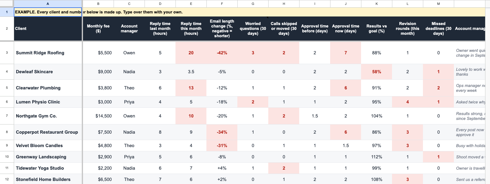

# Client Health Score. See which client might leave

One Google Sheet. Every client is green, amber or red, with the reason. Every Monday you get one message that says who to look at first.

$12K per client protected with a churn warning system for a mortgage coaching academy.

From the client churn video on [my YouTube channel](https://www.youtube.com/@Hamzaouladd).

*Every client in this repo is made up. Every name and number in it is an example.*



## Why this works

Two things make a client stay. They get results, and they know you are the one getting them those results.

When you have a few clients, you feel it when one is unhappy. Once you have 20 clients, you can't be on every call or read every message. The signs are still there: slower replies, shorter emails, the same worried question again. This puts them on one sheet.

## What you get

- `template/client-health-template.xlsx` is the sheet from the video. Import it into Google Sheets and type over the examples.
- `prompts/paste-into-ai.md` gets a client's numbers with no code. Paste it into Claude or ChatGPT with that client's messages.
- `apps-script/Code.gs` sends the Monday message from the sheet to your Slack.
- `health.py` is the whole system as one script. It reads your messages, does the math, scores each client and sends the message. Python 3 only. Nothing to install.
- `PROMPT.md` is the build prompt. Paste it into Claude Code in an empty folder and Claude builds the system with you from zero.
- `CLAUDE.md` tells Claude Code what to do inside this repo. Open Claude Code here and it walks you through the steps.
- `prompts/` has short follow ups: connect your messages, send the numbers to your sheet, run it every Monday, add a signal.
- `test_health.py` checks the script against what the sheet shows, client by client.

## See it before you connect anything

```bash
python3 health.py sample
```

```
Client health, Monday

🔴 Summit Ridge Roofing: Replies 4x slower than last month, 3 worried questions, 2 calls skipped or moved, emails 42% shorter, approvals 3.5x slower
🔴 Dewleaf Skincare: Results at 58% of goal, 1 missed deadline
🟠 Clearwater Plumbing: Replies 2.2x slower than last month, 2 missed deadlines, approvals 3x slower
🟠 Lumen Physio Clinic: 2 worried questions, 1 missed deadline, 4 revision rounds
🟠 Northgate Gym Co.: Replies 2.5x slower than last month, 2 calls skipped or moved
🟠 Copperpot Restaurant Group: Emails 34% shorter, approvals 3x slower, 3 revision rounds

🟢 9 clients green
```

Nothing is connected and nothing leaves your computer. These clients are made up.

## Three ways to set it up

It should take you maybe two or three hours.

### 1. Only the sheet, with no code

1. In Google Sheets, go to File, Import, and upload `template/client-health-template.xlsx`.
2. On the Clients tab, type over the examples. One row per client. Leave Score, Status and Why alone. They are formulas.
3. For each client, paste `prompts/paste-into-ai.md` into Claude or ChatGPT with their messages. Paste the line you get back into their row.
4. Open the Monday in Slack tab. That is your message. To send it by itself every Monday, add `apps-script/Code.gs` under Extensions, Apps Script. The steps are on the tab called The script.

### 2. Let Claude Code set it up

```bash
git clone https://github.com/qemoza/client-health-score.git
cd client-health-score
```

Open [Claude Code](https://claude.com/claude-code) in that folder and say: set this up for me. Claude reads `CLAUDE.md` and takes you through it, one step at a time.

### 3. By hand

```bash
cp .env.example .env     # add your OpenRouter key and your Slack webhook
mkdir data               # add your 3 files, see below
python3 health.py read      # AI reads each client's messages
python3 health.py measure   # code works out the numbers
python3 health.py score     # scores each client and writes the message
python3 health.py post      # sends it to your Slack
```

`python3 health.py monday` does all four in order.

## Your 3 files

They go in `data/`. Git ignores that folder, so your client messages never get committed. `sample/data/` shows the shape with made-up messages.

| File | Columns | What goes in it |
|---|---|---|
| `clients.csv` | client, monthly_fee, account_manager, results_vs_goal, note | One row per client. Results against goal, like 88% |
| `messages.csv` | client, sent_at, who, channel, text | Every email or Slack message. `who` is `client` or `us` |
| `events.csv` | client, date, kind, value | `call_skipped`, `call_moved`, `revision_round`, `missed_deadline`, or `approval` with the days it took as the value |

`prompts/connect-your-messages.md` gets Claude Code to fill these from your real tools.

## How the score works

Every client starts at 100. Each signal that fires takes its points off.

| Signal | Fires when | Points off |
|---|---|---|
| Replies slower | Reply time is 2x last month or more | 20 |
| Emails shorter | Emails are 30% shorter or more | 10 |
| Worried questions | 2 or more in 30 days | 15 |
| Calls skipped or moved | 2 or more in 30 days | 15 |
| Approvals slower | Approvals take 3x as long or longer | 10 |
| Results under goal | Results are under 80% of goal | 40 |
| Revision rounds | 3 or more this month | 10 |
| Missed deadlines | Any in 30 days | 15 |

Green is 75 and up. Amber is 50 to 74. Red is under 50.

Which signals count changes from business to business, so change them. The points are in `rules.json` and on the How the score works tab. If you use both, change both.

## When a client goes red

It is a signal, so don't panic. It shows you where to look.

1. Read the reason. Then read the back and forth with that client.
2. One shorter email means nothing. Look at this month against last month.
3. Ask if they are getting results. If they are not, get them the results.
4. If they are, show them the results. Tell them on the call what you got them. Let them see it every day: here's what we've done, here's what we're doing, here are the next steps.

Sometimes there is no real problem. It is better to check than to find out the day they leave.

## How it stays honest

- It only tells you. Nothing in here writes to a client.
- Your client messages go to the AI company you pick. Check that your client contracts allow it.

And when you run `health.py`:

- Code does the math. AI only reads the words. If the AI quotes a line that is not in the messages, the code throws it away.
- A number with no source stays blank. The Monday message names what is missing: a client it could not read, a client with no results number, a name in your files that is not in `clients.csv`.
- A message of yours still waiting for an answer counts toward reply time, so a client who stops answering shows up.
- Reply time counts nights and weekends. Read it against last month, never on its own.

MIT license. Use it as you like.
